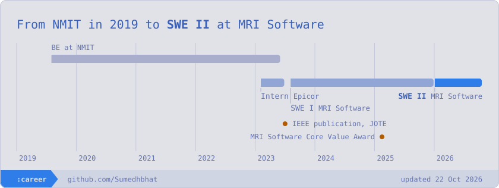
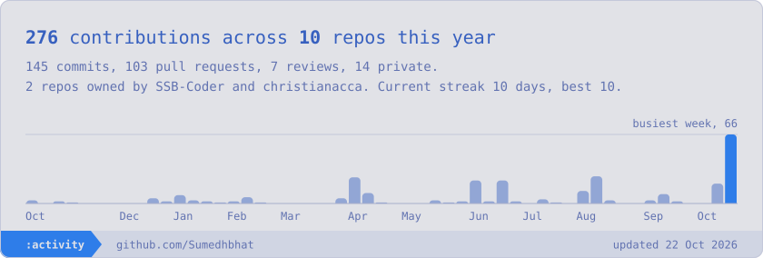
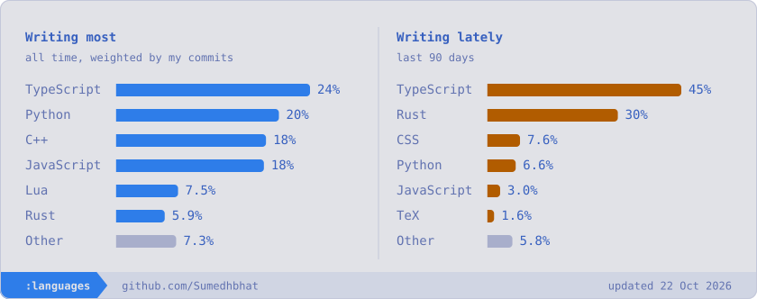
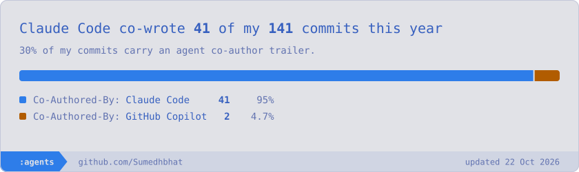

<picture>
  <source media="(prefers-color-scheme: dark)" srcset="assets/hero-dark.svg" />
  
</picture>

# Hi, I'm Sumedh 👋

<!-- INTRO:START -->
I build production software across backend APIs, frontend workflows, identity, platform automation, and applied AI. My work spans architecture through delivery, with a focus on systems that are easier to operate, safer to scale, and clearer for the people using them.

Right now I'm a **Software Engineer II** at **MRI Software** in Bengaluru, India. I own architecture and delivery across full-stack and applied AI work; mentor two junior engineers and review production code for four teammates.
<!-- INTRO:END -->

I couldn't go back to VS Code after a taste of Vim, so these cards wear my Neovim theme. Reach me at [sumedhbhat01@icloud.com](mailto:sumedhbhat01@icloud.com), or see the [portfolio source](https://github.com/Sumedhbhat/portfolio).

 <a href="https://www.github.com/SumedhBhat" target="_blank" rel="noreferrer"> <picture> <source media="(prefers-color-scheme: dark)" srcset="https://raw.githubusercontent.com/danielcranney/readme-generator/main/public/icons/socials/github-dark.svg" /> <source media="(prefers-color-scheme: light)" srcset="https://raw.githubusercontent.com/danielcranney/readme-generator/main/public/icons/socials/github.svg" />  </picture> </a> <a href="https://www.linkedin.com/in/sumedh-s-bhat" target="_blank" rel="noreferrer"> <picture> <source media="(prefers-color-scheme: dark)" srcset="https://raw.githubusercontent.com/danielcranney/readme-generator/main/public/icons/socials/linkedin-dark.svg" /> <source media="(prefers-color-scheme: light)" srcset="https://raw.githubusercontent.com/danielcranney/readme-generator/main/public/icons/socials/linkedin.svg" />  </picture> </a> <a href="https://www.x.com/theavidcoder" target="_blank" rel="noreferrer"> <picture> <source media="(prefers-color-scheme: dark)" srcset="https://raw.githubusercontent.com/danielcranney/readme-generator/main/public/icons/socials/twitter-dark.svg" /> <source media="(prefers-color-scheme: light)" srcset="https://raw.githubusercontent.com/danielcranney/readme-generator/main/public/icons/socials/twitter.svg" />  </picture> </a>

<!-- PORTFOLIO:START -->
### What I'm building

- **Agora Insights** at MRI Software: A cloud-based analytics and business intelligence platform for visualizing, analyzing, and managing large real-estate portfolios. `Angular` `.NET` `EF Core` `Power BI Embedded` `Azure`
- **Agora Intelligence** at MRI Software: An applied-AI product that generates property-risk insights through a six-node workflow. `Python` `LangGraph` `FastAPI` `MCP` `LLM evaluation`
- **HackerFeed Web** ([repository](https://github.com/Sumedhbhat/hackerfeed-web)): A full-stack Hacker News and AI-papers reader with saved favorites, authentication, ingestion, typed API boundaries, observability, and persistent data on Cloudflare. `TanStack Start` `React 19` `Cloudflare Workers` `D1` `tRPC` `WorkOS`
- **Staff Engineer’s Path Resource Atlas** ([repository](https://github.com/Sumedhbhat/staff-engineers-path-resource-atlas)): A filterable chapter-by-chapter index of resources from Tanya Reilly’s book, running DuckDB-Wasm and Drizzle entirely in the browser and deployed through GitHub Pages. `TypeScript` `DuckDB-Wasm` `Drizzle` `GitHub Pages`

### Shipped at work

| What | Impact |
|---|---|
| **Deployment orchestration platform** .NET, Azure Functions, REST, CI/CD | Replaced a manually monitored monthly rollout that required 1–2 days. |
| **Multi-tenant connection service** .NET, Kubernetes, Authorization, SQL | Supported approximately 600 concurrent connections while avoiding repeated 6–7 second setup latency and socket exhaustion. |
| **Production monitoring system** Angular, .NET, Health APIs, Automation | Surfaced failures that had previously remained undetected for up to a month. |
| **Identity and access provisioning** GitHub Apps, GitHub Actions, Entra ID, OIDC | Reduced ticket-driven onboarding from 1–2 days to approximately 15 minutes. |
| **Dashboard state and publishing** Angular, RxJS, State design, Publishing | Removed manual post-deployment setup and received positive feedback from 20+ clients. |

### Earlier projects

- **JOTE Meeting Summarizer** (2022–23, [repository](https://github.com/Sumedhbhat/MeetingSummarizer), [ieee paper](https://ieeexplore.ieee.org/document/10390455)): A meeting and lecture summarizer that captures audio and optional screen regions, generates concise notes, and exports the result as a PDF.
- **Face Recognition System** (2022, [repository](https://github.com/Sumedhbhat/FRS)): An attendance and access-management system with enrollment, database management, and real-time recognition workflows, developed during earlier machine-learning work.

### Recognition

- **MRI Software Core Value Award**: Recognition awarded by MRI Software in Q1 2025.
- **IEEE publication, JOTE**: Co-authored research on concise meeting summaries from audio and video inputs.
- **Top 10% on LeetCode**: Reached a rating of 1690.
- **1st place, FIL Bangalore**: Blockchain hackathon organized by Huddle and IPFS.

### Toolbox

| | |
|---|---|
| **Languages** | C#, TypeScript, Python, SQL, JavaScript |
| **Backend & APIs** | .NET, ASP.NET Core, EF Core, FastAPI, REST APIs, SQL Server |
| **Frontend** | Angular, RxJS, React, TanStack Start, Nuxt |
| **Applied AI** | LangGraph, MCP, LLM evaluation, NLP |
| **Security** | OIDC, Microsoft Entra ID, multi-tenant authorization, row-level access control |
| **Delivery & quality** | xUnit, Moq, Cypress, Vitest, GitHub Actions, Azure DevOps, Cloudflare |
<!-- PORTFOLIO:END -->

### Path so far

<picture>
  <source media="(prefers-color-scheme: dark)" srcset="assets/career-dark.svg" />
  
</picture>

### On GitHub this year

<picture>
  <source media="(prefers-color-scheme: dark)" srcset="assets/overview-dark.svg" />
  
</picture>

<picture>
  <source media="(prefers-color-scheme: dark)" srcset="assets/languages-dark.svg" />
  
</picture>

<picture>
  <source media="(prefers-color-scheme: dark)" srcset="assets/agents-dark.svg" />
  
</picture>

<!-- STATS:START -->

Data behind these cards (updated 2026-10-22)

| Last 12 months | |
|---|---|
| Contributions | 279 |
| Commits | 146 |
| Pull requests / reviews | 105 / 7 |
| Repositories contributed to | 12 |
| Org / team repos | 2 (SSB-Coder, christianacca) |
| Private contributions | 14 |
| Current / longest streak | 10d / 10d |

| Language, all time | Share |
|---|---|
| TypeScript | 24% |
| Python | 20% |
| C++ | 18% |
| JavaScript | 18% |
| Lua | 7.5% |
| Rust | 5.9% |
| Other | 7.3% |

| Language, last 90 days | Share |
|---|---|
| TypeScript | 46% |
| Rust | 31% |
| CSS | 7.7% |
| Python | 6.7% |
| JavaScript | 1.8% |
| TeX | 1.6% |
| Other | 5.9% |

| Agent | Commits | Share |
|---|---|---|
| Claude Code | 40 | 95% |
| GitHub Copilot | 2 | 4.8% |

<!-- STATS:END -->

Everything above the timeline comes from my [portfolio data](https://github.com/Sumedhbhat/portfolio/tree/master/data/portfolio), and the cards rebuild daily from GitHub. [See how](scripts/build-stats.mjs).
