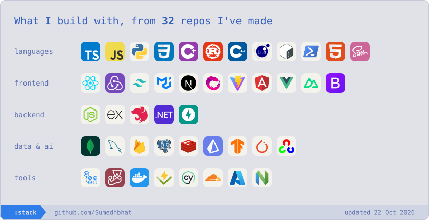

<picture>
  <source media="(prefers-color-scheme: dark)" srcset="assets/profile-hero-dark.svg" />
  
</picture>

# Hi, I'm Sumedh 👋

<!-- INTRO:START -->
I build full stack and applied AI software from Bengaluru, India. Here's what I've built in the open.
<!-- INTRO:END -->

 <a href="https://www.github.com/SumedhBhat" target="_blank" rel="noreferrer"> <picture> <source media="(prefers-color-scheme: dark)" srcset="https://raw.githubusercontent.com/danielcranney/readme-generator/main/public/icons/socials/github-dark.svg" /> <source media="(prefers-color-scheme: light)" srcset="https://raw.githubusercontent.com/danielcranney/readme-generator/main/public/icons/socials/github.svg" />  </picture> </a> <a href="https://www.linkedin.com/in/sumedh-s-bhat" target="_blank" rel="noreferrer"> <picture> <source media="(prefers-color-scheme: dark)" srcset="https://raw.githubusercontent.com/danielcranney/readme-generator/main/public/icons/socials/linkedin-dark.svg" /> <source media="(prefers-color-scheme: light)" srcset="https://raw.githubusercontent.com/danielcranney/readme-generator/main/public/icons/socials/linkedin.svg" />  </picture> </a> <a href="https://www.x.com/theavidcoder" target="_blank" rel="noreferrer"> <picture> <source media="(prefers-color-scheme: dark)" srcset="https://raw.githubusercontent.com/danielcranney/readme-generator/main/public/icons/socials/twitter-dark.svg" /> <source media="(prefers-color-scheme: light)" srcset="https://raw.githubusercontent.com/danielcranney/readme-generator/main/public/icons/socials/twitter.svg" />  </picture> </a>

 

### Open source

<!-- PROJECTS:START -->
- **[HackerFeed Web](https://github.com/Sumedhbhat/hackerfeed-web)**: A full-stack Hacker News and AI-papers reader
- **[autoskeleton](https://github.com/Sumedhbhat/autoskeleton)**: Wrap any React component in &lt;Skeleton loading&gt; and get a pixel-accurate skeleton of it
- **[portfolio](https://github.com/Sumedhbhat/portfolio)**: A resume tracker with an artifact creator
- **[Staff Engineer’s Path Resource Atlas](https://github.com/Sumedhbhat/staff-engineers-path-resource-atlas)**: A filterable chapter-by-chapter index of resources from Tanya Reilly’s book
- **[my_nvim_config](https://github.com/Sumedhbhat/my_nvim_config)**: My Personal Neovim config
- **[travel-log](https://github.com/Sumedhbhat/travel-log)**: A travel log build using the Nuxt ecosystem · ★ 4
- **[JOTE Meeting Summarizer](https://github.com/Sumedhbhat/MeetingSummarizer)**: A meeting and lecture summarizer · [ieee paper](https://ieeexplore.ieee.org/document/10390455)
- **[Face Recognition System](https://github.com/Sumedhbhat/FRS)**: An attendance and access-management system
<!-- PROJECTS:END -->

 

### Tech I build with

<picture>
  <source media="(prefers-color-scheme: dark)" srcset="assets/stack-dark.svg" />
  
</picture>

 

### On GitHub this year

<picture>
  <source media="(prefers-color-scheme: dark)" srcset="assets/overview-dark.svg" />
  
</picture>

 

<picture>
  <source media="(prefers-color-scheme: dark)" srcset="assets/languages-dark.svg" />
  
</picture>

 

<picture>
  <source media="(prefers-color-scheme: dark)" srcset="assets/agents-dark.svg" />
  
</picture>

 

<!-- STATS:START -->

Data behind these cards (updated 2026-10-22)

| Last 12 months | |
|---|---|
| Contributions | 282 |
| Commits | 147 |
| Pull requests / reviews | 107 / 7 |
| Repositories contributed to | 12 |
| Org / team repos | 2 (SSB-Coder, christianacca) |
| Private contributions | 14 |
| Current / longest streak | 10d / 10d |

| Language, all time | Share |
|---|---|
| TypeScript | 24% |
| Python | 20% |
| C++ | 18% |
| JavaScript | 18% |
| Lua | 7.5% |
| Rust | 5.9% |
| Other | 7.3% |

| Language, last 90 days | Share |
|---|---|
| TypeScript | 45% |
| Rust | 30% |
| CSS | 7.6% |
| Python | 6.6% |
| JavaScript | 3.0% |
| TeX | 1.6% |
| Other | 5.8% |

| Agent | Commits | Share |
|---|---|---|
| Claude Code | 41 | 95% |
| GitHub Copilot | 2 | 4.7% |

<!-- STATS:END -->

Cards rebuild daily from GitHub. [See how](scripts/build-stats.mjs).
